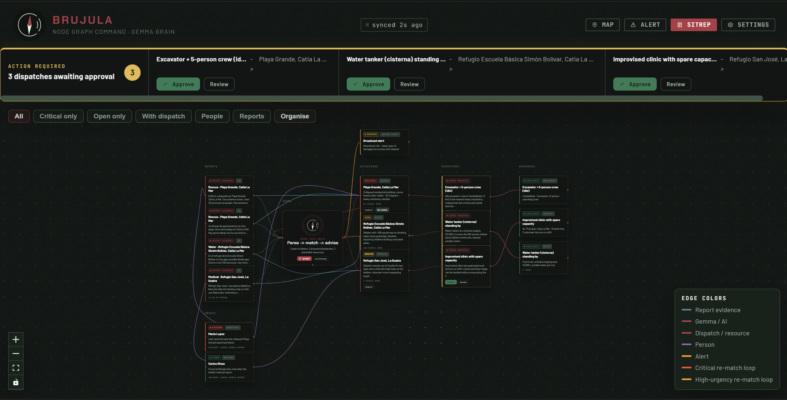
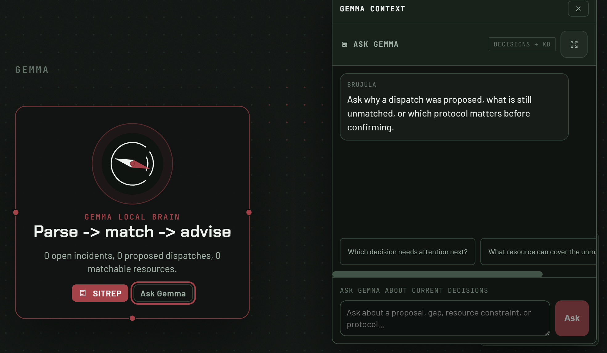
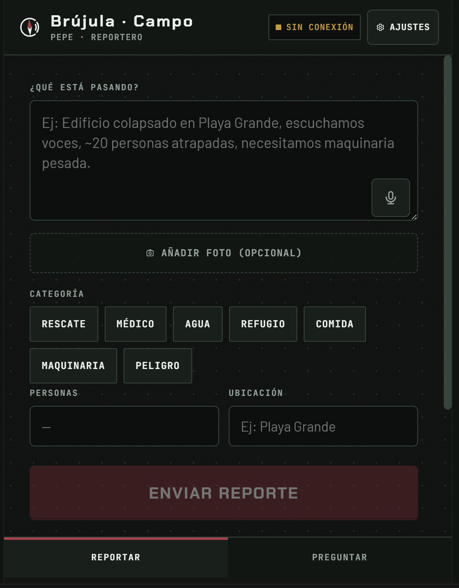
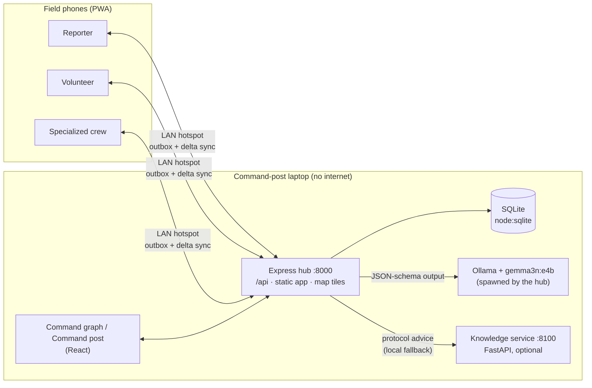

# Brújula: offline disaster-response coordination

[](https://github.com/Ceco1223444/brujula/actions/workflows/ci.yml)


Brújula ("compass" in Spanish) coordinates a disaster response when there is
**no internet at all**. Field responders send messy voice, text and photo reports
from their phones over a laptop's Wi-Fi hotspot. **Gemma, running locally on that
laptop**, turns them into structured incidents, merges duplicates, ranks them
and proposes which crew to send. A human coordinator confirms every dispatch,
and the assignment syncs back to the crew's phone.

Built in about 24 hours by a remote team of four at the **RAISE Summit Hackathon
2026** (Google DeepMind track: edge / on-device Gemma). This is my copy for my
portfolio; the team repo is
[nickpalade/Brujula](https://github.com/nickpalade/Brujula). See
[Team and my part](#team-and-my-part).



## Why offline-first

The scenario was the June 2026 earthquakes on Venezuela's La Guaira / Caracas
corridor: power and networks down, dozens of agencies and volunteers reporting
at once, mostly in Spanish and often contradicting each other. Typical failures
are two crews sent to the same collapse while another site waits, or water
trucks idling near a shelter with no drinking water.

Cloud AI is unreachable exactly when it is needed, and the reports carry
missing-person names, medical status and the locations of vulnerable people.
So Brújula assumes **no internet in the field**: one laptop and the phones on its
hotspot. After a one-time setup (model download, `npm install`, map tiles),
nothing leaves the local network.

## What it does

1. **Field phones** (installable PWA) send reports with voice, text, photo and
   GPS through a store-and-forward outbox, so nothing is lost when the radio
   link drops.
2. **A Gemma agent on the laptop** runs every report through
   parse → dedup → prioritize → match, then adds protocol advice on demand.
3. **The coordinator decides.** Gemma only proposes. Confirm, override,
   rematch, edit and broadcast alerts stay with a human.
4. **Assignments sync back** over the LAN. The crew's phone shows where to go
   and why, and the crew moves the job through *accepted → en route → on site →
   done*. A crew that registers late triggers new proposals for open needs.

| Command graph + Ask Gemma | Mobile field report |
|---|---|
|  |  |
| Reports flow into the central Gemma node; incidents and dispatch proposals flow out. The coordinator can ask grounded questions and apply the board edits Gemma suggests with one click. | Reports are saved on the phone first and sync when the hub is reachable. |

## Architecture



- **One Node server** serves the API, the built React app, the offline map tiles
  and the model controls. Phones open `http://<laptop-ip>:8000/field` and add it
  to their home screen. No app store and no accounts.
- **One React app, two surfaces:** `/graph` (command graph, the main coordinator
  view), `/command` (older feed view) and `/field` (mobile PWA).
- The **knowledge service** is a separate Python service that serves humanitarian
  protocols (INSARAG, START triage, Sphere WASH, WHO/PAHO). If it is down, the hub
  falls back to its built-in copy.

## The Gemma agent pipeline

Each `POST /api/reports` runs through [`server/pipeline/`](server/pipeline):

```
raw report (voice / text / photo)
  1. PARSE       Gemma: structured record + named persons    (JSON schema)
  2. DEDUP       Gemma: same incident as an open one? merge   (ids enum-locked)
  3. PRIORITIZE  deterministic: urgency x people x age        (0 model calls)
  4. MATCH       Gemma: best available resource + rationale   (ids enum-locked)
  5. ADVISE      protocol steps from the knowledge base       (on demand)
  6. EMIT        dispatch proposal -> human confirm / override
```

Design choices that make a small local model reliable:

- **Structured output everywhere.** Each step passes a JSON schema to Ollama's
  `format` and re-validates the reply with Zod. Bad output gets one retry, then a
  fallback. It never crashes the hub.
- **Enum-locked references.** In dedup and match, the schema only allows ids that
  exist on the board, so the model cannot invent an incident or a resource.
- **Server-side guardrails.** A category backstop blocks implausible merges (e.g.
  a water request merging into a building collapse), resource offers cannot
  merge into needs, and engaged crews are excluded from matching.
- **Deterministic ranking.** Prioritization is plain arithmetic: fast,
  explainable and safe on a CPU-only laptop.
- **Graceful degradation.** If the model fails after parsing, the report is kept
  and the board keeps working. Phones get a fast ack (≤ 20 s) while parsing
  finishes in the background.
- **Explicit corrections.** A report like *"not 180 people, actually 60"* updates
  the right incident instead of creating a new one.

## Engineering highlights

| Area | What we built |
|---|---|
| Offline sync | Store-and-forward outbox on the phone (queued → synced → parsed), idempotent `client_ref`, `GET /api/sync?since=<seq>` delta sync on a monotonic sequence |
| Persistence | SQLite through Node's built-in `node:sqlite`; the board survives restarts; snapshot export / import / reset |
| Local model ops | The hub spawns a headless `ollama serve`; model manager (install, switch, pull progress), warmup, GPU / CPU toggle |
| Multimodal | Photos are compressed on the phone, read once by Gemma at parse time and never stored (only a `has_image` flag) |
| Voice | Phone recording → local speech-to-text on the hub (pluggable, e.g. faster-whisper); audio is not kept |
| Maps | Leaflet map with pre-downloaded tiles served by the hub; offline gazetteer when there is no GPS fix |
| Command graph | React Flow board: reports → Gemma → incidents → dispatches → resources, with an inspector, filters, approval queue, edge routing around cards and keyboard access |
| Safety | Coordinator-only command views (blocked for remote devices), human confirmation on every dispatch, protocol content is operational guidance and never diagnosis |
| i18n | Spanish and English UI; board summaries in a configurable language |

## Tech stack

**Hub:** Node.js 22.5+, Express 5, Zod, `node:sqlite`, Ollama (`gemma3n:e4b`)
**Frontend:** React 19, Vite, React Flow (`@xyflow/react`), Leaflet, GSAP, PWA
**Knowledge service:** Python, FastAPI, pytest
**Quality:** oxlint, Node test runner, Playwright, GitHub Actions

## Run it

### Quick look, no GPU or model needed

The mock provider answers deterministically, so the whole flow works on any
machine:

```bash
npm install
npm run build

# macOS / Linux
BRUJULA_PROVIDER=mock BRUJULA_CHAT_PROVIDER=mock npm start
# Windows PowerShell
$env:BRUJULA_PROVIDER="mock"; $env:BRUJULA_CHAT_PROVIDER="mock"; npm start
```

Open <http://localhost:8000>, pick **Command Graph** on the laptop, and open the
printed LAN address with `/field` on a phone on the same network (or a second
browser tab).

### Full offline setup with Gemma

```bash
# once, with internet: installs Ollama, pulls gemma3n:e4b, checks Node >= 22.5
bash bootstrap.sh                                      # macOS / Linux
powershell -ExecutionPolicy Bypass -File bootstrap.ps1 # Windows

npm install && npm run build
npm start                         # hub on :8000, spawns Ollama itself
curl -X POST http://localhost:8000/warmup   # load the model before first use
```

Optional extras:

- **Map tiles:** Command Graph → Settings → Offline maps, or `npm run fetch:tiles`.
- **Knowledge service:** `cd knowledge-service && pip install -r requirements.txt && uvicorn app:app --port 8100`,
  then start the hub with `PROTOCOL_KB_URL=http://localhost:8100`.
- **Voice:** set `BRUJULA_TRANSCRIBE_COMMAND` to a local STT command, e.g.
  `python scripts/transcribe-local.py {input} {lang} {output}` (needs `faster-whisper`).

A step-by-step demo script with sample reports is in
[docs/demo-runbook.md](docs/demo-runbook.md).

### Configuration

| Variable | Default | Purpose |
|---|---|---|
| `BRUJULA_PORT` / `BRUJULA_HOST` | `8000` / `0.0.0.0` | Hub address |
| `BRUJULA_MODEL` | `gemma3n:e4b` | Ollama model for the pipeline |
| `BRUJULA_PROVIDER`, `BRUJULA_CHAT_PROVIDER` | (Ollama) | `mock` for a deterministic provider without a model |
| `BRUJULA_LANG` | `en` | Language for board summaries |
| `PROTOCOL_KB_URL` | (built-in KB) | Proxy protocol advice to the knowledge service |
| `BRUJULA_TRANSCRIBE_COMMAND` | (off) | Local speech-to-text command template |
| `BRUJULA_DATA_DIR` | `data/` | Where SQLite and tiles live |
| `CLOUD_API_KEY` | (off) | Dev-only cloud fallback. Leave unset in the field, otherwise reports leave the laptop |

## Tests

```bash
npm run lint                 # oxlint
npm test                     # 26 hub contract tests, mock provider, no model
npm run test:e2e             # 25 Playwright tests against the app in mock mode
cd knowledge-service && python -m pytest -q   # 31 protocol + safety tests
```

CI runs all of the above on every push. Against a running hub with the real
model, `npm run verify:hub` replays the demo end to end (15 checks) and
`npm run verify:kb` checks the knowledge service contract.

## Repository layout

```
server/              Express hub: routes, pipeline (Gemma steps), SQLite store, Ollama lifecycle, tiles
app/                 React app: /graph, /command, /field (PWA) + Playwright tests
knowledge-service/   FastAPI protocol service + contract (CONTRACT.md) + tests
fixtures/            Demo seed data (npm run seed) and the offline gazetteer
scripts/             Seeding, tile download, local transcription
tests/               Hub contract tests (node:test)
docs/                PRD, Gemma research brief, demo runbook, pipeline decision record
design/              Brand, tokens and the design exploration
experiments/         Hour-1 offline networking spike
verify*.js           End-to-end checks against a live hub / knowledge service
```

## Team and my part

| Who | Focus |
|---|---|
| José María "Pepe" ([@josemacontrerasp-arch](https://github.com/josemacontrerasp-arch)) | Gemma agent core, integration lead, field app, design system |
| Nick ([@nickpalade](https://github.com/nickpalade)) | Shared React frontend, command graph, coordination workflows |
| Rares ([@strabunul236](https://github.com/strabunul236)) | Offline protocol knowledge service, GPS and offline maps |
| Ceco ([@Ceco1223444](https://github.com/Ceco1223444)) | Hub backend and offline sync |

My part (Ceco):

- **De-risked the core idea in hour 1.** Before any product code I built a small
  FastAPI spike ([experiments/ceco-fastapi-spike](experiments/ceco-fastapi-spike))
  showing that a phone on a laptop hotspot, with no internet anywhere, can post
  reports to the laptop.
- **Persistence.** Moved the hub's incident board from a JSON file to SQLite
  (`node:sqlite`), so the board survives restarts.
- **One pipeline instead of two.** The team had two parallel agent stacks with
  separate stores and schemas. I removed the legacy one (about 1,250 lines) so
  every fix landed once and the demo had a single source of truth. See
  [docs/single-pipeline-decision.md](docs/single-pipeline-decision.md).
- **UI pass.** Applied the final "Bosque" theme, logo and urgency glyphs across
  the command post and field client, and simplified the command header and
  incident cards after team feedback.
- **After the event,** for this copy: updated the tests that had fallen behind
  the last UI changes, fixed a horizontal-overflow bug on narrow screens, and
  set CI back up.

The full commit history is kept, so every teammate's commits are still credited
to them.

## Known limitations

- Built in a weekend: there is no authentication beyond restricting the command
  views to the laptop itself, so it assumes a trusted hotspot.
- Phones only receive assignments while the PWA is open (they poll the hub).
  There are no push notifications, since there is no internet.
- Browsers usually block GPS on plain-HTTP LAN origins, so the gazetteer fallback
  places most pins.
- The intended setup is a laptop with a GPU. On CPU, Gemma takes noticeably
  longer per report.

## More docs

- [docs/PRD.md](docs/PRD.md): the product spec written at the start of the hackathon
- [docs/gemma-research.md](docs/gemma-research.md): model research for the on-device track
- [docs/demo-runbook.md](docs/demo-runbook.md): the one-minute demo, with fallbacks
- [knowledge-service/CONTRACT.md](knowledge-service/CONTRACT.md): protocol service API contract
- [app/README.md](app/README.md) and [design/README.md](design/README.md)
